<div align="center">

</div>

# aicf-core

> **The engine, not the app.** A scenario-agnostic agent core: turn loop, tool protocol,
> context assembly, memory, sessions, multi-agent collaboration — and nothing else.

[English](README.md) · [中文](README_zh.md) · [文档](docs/README.md)


**AICF** = Agent Infrastructure Cybernetics Framework · Apache-2.0

---

## 📦 Install

```bash
pip install aicf-core
```

That is the whole library — the agent kernel and the model/tool/runtime layer.
It has **no application code and no UI**: products live in their own repositories (see below).

Optional extras, installed only when you need them:

```bash
pip install "aicf-core[personality]"   # personality dynamics (PEV3)
pip install "aicf-core[decisions]"     # System-1 decision head
pip install "aicf-core[learning]"      # trajectory → dataset → judge → promotion loop
pip install "aicf-core[finetune]"      # local SFT (pulls torch)
pip install "aicf-core[mcp]"           # external MCP tool servers
pip install "aicf-core[all]"           # everything
```

---

## 🧩 What you get

| You need… | Module |
|---|---|
| A turn loop that only depends on `IChatClient + ToolRegistry` | `harness.agent.loop` |
| A tool protocol with ownership tracking, diff snapshots, MCP bridge | `harness.tools` |
| Context assembly under a token budget, with compaction | `harness.context_assembly` |
| Memory stores (in-memory / vector) behind a port protocol | `harness.memory` |
| Sessions that survive a restart (sqlite + atomic transcripts) | `harness.transcript`, `infra.store` |
| Sub-agent collaboration by mailbox, with depth and concurrency limits | `harness.agent.collab` |
| Model routing across llama.cpp / LM Studio / OpenAI / Anthropic, with failover | `infra.orchestrator` |
| VRAM-aware scheduling for local models (and ASR/TTS/decision models) | `infra.resources` |
| Budgets, retries, token accounting, policy | `infra.policy` |
| A structured event stream you can build traces on | `harness.agent.events` |

---

## 🚀 Sixty seconds

```python
from harness import create_agent
from harness.tools import tool_from_function

def add(a: int, b: int) -> int:
    """Add two numbers."""
    return a + b

agent = create_agent(
    model="deepseek-chat",
    base_url="https://api.deepseek.com/v1",
    api_key="sk-...",                 # or just export OPENAI_API_KEY
    tools=[tool_from_function(add)],
)

result = agent.run("what is 17 + 25?")
print(result.reply)
```

Any OpenAI-compatible endpoint works. For a local model, point `base_url` at your
`llama-server` / LM Studio, or hand `create_agent` a client
(`infra.orchestrator.LlamaCppChat`, `LMStudioChat`, `OpenAICompatClient`, …) —
see [docs/sdk_guide.md](docs/sdk_guide.md).

---

## 🗺️ The repo in 30 seconds

Two layers, dependencies pointing **downward only**:

```
harness/   Agent core    turn loop · tools · context · memory · pipeline · sessions · SDK
   │                      knows nothing about any product
   ▼
infra/     Infra         model routing · resource pool · storage · gateway · auth · policy
```

```
apps/  →  gone. Products now live in their own repositories:
```

| Repository | What it is |
|---|---|
| [`aicf-ui`](https://github.com/ccjjfdyqlhy/aicf-ui) | Web console — models, chat, resources, System-1 decisions |
| [`aicf-dsn`](https://github.com/ccjjfdyqlhy/aicf-dsn) | Voice companion — real-time audio, emotion, topic memory |
| [`aicf-study`](https://github.com/ccjjfdyqlhy/aicf-study) | Study assistant — question banks, mock exams, knowledge graph |
| [`aicf-code`](https://github.com/ccjjfdyqlhy/aicf-code) | Terminal coding agent — the smallest complete example |
| [`DSN-legacy`](https://github.com/ccjjfdyqlhy/DSN-legacy) | Archived snapshot of the old monorepo |

Every one of them depends on `aicf-core` and nothing else.

---

## 🧪 Development

```bash
git clone https://github.com/ccjjfdyqlhy/aicf-core.git && cd aicf-core
pip install -e ".[mcp,anthropic,socks]"
pip install pytest pytest-asyncio
python -m pytest -q tests/
```

---

## 📚 Documentation

| I want to… | Read this |
|---|---|
| Learn the module map and dependency rules | [docs/architecture.md](docs/architecture.md) |
| Use the core as a library | [docs/sdk_guide.md](docs/sdk_guide.md) |
| Go deeper into the agent loop / tools / context | [docs/harness.md](docs/harness.md) |
| Go deeper into model routing / resources / storage | [docs/infra.md](docs/infra.md) |
| Know which traps not to step into before changing code | [docs/maintenance.md](docs/maintenance.md) |
| Configuration keys / environment variables | [docs/configuration.md](docs/configuration.md) |
| Known tech debt and its fix priority | [docs/technical-debt.md](docs/technical-debt.md) |
| How the old monorepo maps onto the new repositories | [docs/split_migration.md](docs/split_migration.md) |

---

## 📄 License

Apache-2.0
