<div align="center">

</div>

# DSN-exp

> 🧠 **Turn a large language model into your own local agent.**
> Model routing, tool calling, memory, personality, voice and a web console — one base covers it all.

[English](README.md) · [中文](README_zh.md) · [文档](docs/README.md)


**Framework codename AICF** (Agent Infrastructure Cybernetics Framework) · internal experimental project · no public license

---

## 🚀 Start in one command

```bash
git clone https://github.com/ccjjfdyqlhy/DSN-exp.git && cd DSN-exp && python3 installer.py
```

The installer creates a virtualenv, installs dependencies, checks the repo, walks you through connecting a model, and finally starts the web console:

**👉 Open <http://127.0.0.1:8888>, then use "Settings → Provider" in the top-right corner to fill in Base URL and API Key — you can chat right away.**

> No GPU? Fine. No local model? Fine.
> No API key yet? You can still start it and look around.

---

## ✨ What it does for you

| You might want… | It's here |
|---|---|
| A web console that manages models, runs conversations and shows resource usage | **`dsn_ui`**, the default entry point, port `8888` |
| A voice companion agent that listens and speaks — see the [old README](https://github.com/ccjjfdyqlhy/DSN-exp/blob/main/README_zh.md) | **`dsn`** |
| Question banks, mock exams, a knowledge graph, study plans | **`dsn_study`** |
| A coding assistant in the terminal | **`coding_agent`** |
| A reusable agent base to build your own apps on | `harness/` + [SDK guide](docs/sdk_guide.md) |
| Local llama.cpp / LM Studio and remote OpenAI-compatible APIs, mixed freely | `infra/orchestrator` |
| Repo, models and dependencies installed on demand | `python3 onboarding.py` |

**In one line: `infra` manages resources, `harness` does the thinking, `apps` carry the product.**

---

## 🗺️ The repo in 30 seconds

Three layers, dependencies pointing **downward only**:

```
apps/     Product      voice companion · web console · study assistant · minimal samples
   │  may only use the capabilities below, and adds product semantics
   ▼
harness/  Agent core   agent loop · tools · context · pipeline · memory · personality · SDK
   │  only cares about "messages in, events out"; knows nothing about voice/study/companionship
   ▼
infra/    Infra        model routing · resource pool · storage · gateway · auth · policy
          knows nothing about any product
```

Your daily entry point is the web console `apps/dsn_ui`. To build an app for a new need, read the
[app development guide](docs/app-development.md) first and follow `apps/dsn_study`
(the tidiest structure) and `apps/coding_agent` (the smallest readable one).

---

### Installer usage

```bash
python3 installer.py                    # full install + guided setup
python3 installer.py --doctor           # check only, change nothing (best for troubleshooting)
python3 installer.py --non-interactive  # no questions, all defaults (CI / containers)
python3 installer.py --branch main      # switch to a branch before installing
python3 installer.py --reinstall        # rebuild .venv and reinstall dependencies
python3 installer.py --port 8899        # use another port (when 8888 is taken)
python3 installer.py --host 0.0.0.0     # allow LAN access (binds 127.0.0.1 by default)
```

### 🧭 Not sure what to install? Let the wizard ask you

```bash
python3 onboarding.py
```

---

## 🎯 What do you want to do next?

| I want to… | Start here |
|---|---|
| **See what it looks like** | run the installer → open <http://127.0.0.1:8888> |
| **Configure it automatically** | `python3 onboarding.py` → pick needs/capabilities, it clones repos and downloads models for you |
| **Chat** | "Settings → Provider" → fill in Base URL + Key |
| **Run a local model** | prepare a GGUF + `llama-server` → write a profile as in [Model Setup](#model-setup) |
| **Write a new app** | [App development guide](docs/app-development.md) |
| **Use AICF as an SDK** | [SDK guide](docs/sdk_guide.md) |
| **Run the tests / contribute** | [Development and tests](#development-and-tests) |
| **Troubleshoot the environment** | `python3 installer.py --doctor` → [maintenance guide](docs/maintenance.md) |

---

## 🧰 Requirements

| Item | Requirement | Notes |
|---|---|---|
| Python | **3.10+** (tested on 3.12) | many machines have no `python` command, only `python3` |
| git | recommended | used to switch branches / update |
| Node.js | **not needed** | only if you change the frontend sources and rebuild (18+) |
| GPU | not needed | remote APIs need no graphics card at all; only local models do |
| Disk | ≥ 2GB | dependencies + models |
---

## ⚙️ Configuration

Configuration comes from three places, **in increasing priority**: environment variables > `.env` > code defaults.

### Shortest path: configure nothing

`dsn_ui` + `densechat` + `emotion_exp` all run with zero configuration. The `.env` the installer writes is
entirely comments, waiting for you to fill it in.

### Configure in the GUI (recommended)

Start the console → "Settings → Provider" in the top-right corner → fill in Base URL and API Key → save.
**No file editing required.**

### Configure `.env` by hand

```bash
cp .env.example .env
```

`.env.example` has 344 lines and 200+ variables, but **almost all of them have defaults** — ignore them.
Only four are actually used:

```ini
MAIN_MODEL_TYPE=openai
MAIN_MODEL_NAME=deepseek-chat
OPENAI_API_BASE=https://api.deepseek.com/v1
OPENAI_API_KEY=sk-your-real-key
```

> The full variable list is categorised in [configuration.md](docs/configuration.md).

---

## Model Setup

### Remote API (easiest)

Any OpenAI-compatible endpoint works (DeepSeek, OpenAI, GLM, Kimi, vLLM, OneAPI…).
Just fill in `OPENAI_API_KEY` / `OPENAI_API_BASE` / `MAIN_MODEL_NAME`.

### Local llama.cpp

You need three things: a compiled `llama-server`, a GGUF weights file, and a model description YAML.

```bash
cp apps/dsn/model_profiles.example/llama_cpp_local.yaml apps/dsn/model_profiles/
# edit model_path / binary_path inside
# restart dsn_ui
```

The template directory `apps/dsn/model_profiles.example/` holds samples you can copy,
and the field reference lives in that directory's `README.md`.

> The repo **does not ship** local models with absolute paths — those paths are only valid on the
> author's machine, and on any other machine they turn into "listed but always fails to load" ghosts.
> `python3 installer.py --doctor` catches dead paths before they bite.

### LM Studio

The console connects to `LMSTUDIO_BASE_URL` automatically at startup (default `http://localhost:4501`).
The web console can also act as a **pure OpenAI-compatible backend** for external clients
(Open WebUI / Continue / LangChain) — in that mode it uses `passthrough`: no prompt injection,
no emotion and no memory. See
[apps/dsn_ui/INTEGRATION_API.md](apps/dsn_ui/INTEGRATION_API.md).

---

## ⌨️ Common commands

```bash
python3 main.py --list                 # list every registered app
python3 main.py --app dsn_ui           # start the web console
python3 main.py --app dsn_study        # study assistant (Flask, :5000)
python3 main.py                        # default app (the DSN UI web console)
DSN_APP=dsn_ui python3 main.py         # the env var works too

python3 -m apps.dsn_ui.server --host 0.0.0.0 --port 8888 --slots 2
python3 -m apps.densechat              # DenseChat WebUI (:8080)
python3 -m apps.emotion_exp            # terminal agent

python3 installer.py --doctor          # environment check (read-only)
```

### Ports at a glance

| Port | Service |
|---|---|
| 8888 | dsn_ui web console |
| 8080 | densechat |
| 5000 | dsn / dsn_study |
| 5050 | dsn debug endpoint (needs `DEBUG_PLAY_AS_MODEL=true`) |
| 8008 | dsn admin panel (needs `WEB_ADMIN_ENABLED=true`) |
| 4501 | LM Studio (connected to) |

> ⚠️ `dsn_ui` **must run as a single process**: SSE broadcasting and the stream session registry
> are in-process singletons — running uvicorn with multiple workers breaks reconnection.

---

## 🏗️ Architecture at a glance

```
infra/          harness/                   apps/
├─ orchestrator ├─ agent/loop.py           ├─ dsn/        voice companion (the largest)
├─ resources    ├─ tools/ (18 std tools)   ├─ dsn_ui/     web console (main entry point)
├─ store        ├─ context_assembly.py    ├─ dsn_study/  study assistant (the reference app)
├─ policy       ├─ memory/ personality/    ├─ coding_agent/
├─ gateway      ├─ pipeline/ (8 HookPoint) ├─ densechat/
└─ runtime.py   └─ sdk.py                 └─ emotion_exp/ text_agent/
```

- **Model routing** (`infra/orchestrator`): one contract over llama.cpp / Strata / LM Studio /
  OpenAI / Anthropic backends (`IChatClient` / `IEmbeddingClient`).
  `ModelScheduler` manages VRAM by priority and concurrency slots.
- **Agent core** (`harness`): multi-step reasoning and tool calls, context trimming under a
  segment budget, vector memory and elastic topic memory, personality dynamics (PEV3),
  pipelines and an event bus, and an embeddable SDK.
- **Dual-system chat**: some models carry a decision head that answers in one forward pass with
  a calibrated probability. System 2 goes through `POST /v1/chat/completions`, System 1 through
  `POST /v1/decide` (yes/no, choice, score — it returns probabilities), web UI path `/#/decide`.

Details in [docs/architecture.md](docs/architecture.md), [docs/harness.md](docs/harness.md) and [docs/infra.md](docs/infra.md).

### Applications

| App | What it is | Shape |
|---|---|---|
| `dsn_ui` | Web console: model management, chat, decisions, resource scheduling | FastAPI + SvelteKit, **main entry point** |
| `dsn` | Voice companion: real-time audio, emotion system, topic memory | Flask + terminal console, the largest app |
| `dsn_study` | Study system: question banks, mock exams, knowledge graph | Flask, **the tidiest reference app** |
| `coding_agent` | Coding assistant sample | terminal REPL |
| `densechat` | DenseChat WebUI clone | FastAPI |
| `emotion_exp` | Emotion state machine experiment | terminal |
| `text_agent` | Minimal placeholder sample | terminal |

---

## Development and tests

```bash
pip install -r requirements.txt
pip install pytest                     # pytest is not in requirements
python3 -m pytest -q                   # full run, about 100 seconds
python3 -m pytest -m known_broken      # the cases waiting to be redone
```

> The repo ships a pytest config: `testpaths` limits collection to `tests/`,
> so running bare `pytest` at the root never wanders into `temp/`
> (where the scripts would **really call external APIs during collection**).

### External MCP tools

`harness/tools/mcp.py` provides the MCP bridge; tools appear as `mcp.<server>.<tool>`,
with server configuration in `mcp_servers.yaml`.

---

## 📚 Documentation

| I want to… | Read this |
|---|---|
| Build the mental model and learn the module map | [docs/architecture.md](docs/architecture.md) |
| Go deeper into the agent loop / tools / context | [docs/harness.md](docs/harness.md) |
| Go deeper into model routing / resource pool / storage | [docs/infra.md](docs/infra.md) |
| **Run it locally and troubleshoot the environment** | [docs/getting-started.md](docs/getting-started.md) |
| **Extend an existing app / write a new one** | [docs/app-development.md](docs/app-development.md) |
| Know what each app does and how to start it | [docs/apps.md](docs/apps.md) |
| Embed AICF as an SDK in your own project | [docs/sdk_guide.md](docs/sdk_guide.md) |
| **Know which traps not to step into before changing code** | [docs/maintenance.md](docs/maintenance.md) |
| Configuration keys / environment variables | [docs/configuration.md](docs/configuration.md) |
| Run tests and read a failure | [docs/testing.md](docs/testing.md) |
| **Known tech debt and its fix priority** | [docs/technical-debt.md](docs/technical-debt.md) |

---

## 📌 Project status

[](https://repostars.dev/?repos=ccjjfdyqlhy%2FDSN-exp&theme=ocean)
