<div align="center">

</div>

# aicf-core

> **是引擎，不是应用。** 场景无关的 Agent 内核：轮次循环、工具协议、上下文装配、
> 记忆、会话持久化、多智能体协作——只有这些，没有别的。

[English](README.md) · [中文](README_zh.md) · [文档](docs/README.md)


**AICF** = Agent Infrastructure Cybernetics Framework · Apache-2.0

---

## 📦 安装

```bash
pip install aicf-core
```

装完就是整个库——Agent 内核 + 模型/工具/运行时层。
**不含任何应用代码和界面**：Web 控制台在独立的仓库里（见下表）。

可选 extra，用到哪块再装哪块：

```bash
pip install "aicf-core[personality]"   # 人格动态（PEV3）
pip install "aicf-core[decisions]"     # System-1 决策头
pip install "aicf-core[learning]"      # 轨迹 → 数据集 → 分层判官 → 晋级 闭环
pip install "aicf-core[finetune]"      # 本地 SFT（会拉 torch）
pip install "aicf-core[mcp]"           # 外部 MCP 工具源
pip install "aicf-core[all]"           # 全都要
```

---

## 🧩 你能拿到什么

| 你需要… | 模块 |
|---|---|
| 只依赖 `IChatClient + ToolRegistry` 的轮次循环 | `harness.agent.loop` |
| 带归属追踪、diff 快照、MCP 桥接的工具协议 | `harness.tools` |
| 预算内的上下文装配与压缩 | `harness.context_assembly` |
| 端口协议背后的记忆存储（内存 / 向量） | `harness.memory` |
| 重启后还在的会话（sqlite + 原子 transcript） | `harness.transcript`、`infra.store` |
| 邮箱式多智能体协作，带深度与并发上限 | `harness.agent.collab` |
| llama.cpp / LM Studio / OpenAI / Anthropic 的模型路由与故障转移 | `infra.orchestrator` |
| 面向显存的本地模型调度（含 ASR/TTS/决策模型） | `infra.resources` |
| 预算、重试、token 计量、策略 | `infra.policy` |
| 可直接用来搭 trace 的结构化事件流 | `harness.agent.events` |

---

## 🧩 只想写个 Agent？五个符号就够了

大多数人只需要下面五个。`harness` 里其余的东西，是给要在它**之上建平台**的人准备的。

```python
from harness import Agent, create_agent, tool   # 你真正会写的三个
from harness.tools import ToolRegistry           # 自己管工具注册表时才用
from infra.models.base import IChatClient        # 模型接口
```

| 符号 | 是什么 |
|---|---|
| `tool` | 把带类型注解的函数变成工具（schema 从签名自动生成） |
| `Agent` | 绑定到某个客户端的 agent——`chat()` / `run()` / `chat_stream()` |
| `create_agent` | 一行工厂：模型 + key + 工具 |
| `ToolRegistry` | 工具表（只有自己注册工具时才需要） |
| `IChatClient` | 模型接口——实现它就能接自己的后端 |

其余的（`harness.agent.*`、`harness.tools.standard`、`infra.*`）是给需要它们的人，
不是给只想写个 agent 的人的。

## 🚀 六十秒

```python
from harness import create_agent, tool

@tool
def add(a: int, b: int) -> int:
    """把两个数相加。"""
    return a + b

agent = create_agent(
    model="deepseek-chat",
    base_url="https://api.deepseek.com/v1",
    api_key="sk-...",                 # 或者直接 export OPENAI_API_KEY
    tools=[add],
)

result = agent.run("17 + 25 等于多少？")
print(result)                        # 结果对象也能直接当字符串用
```

任意 OpenAI 兼容端点都行。用本地模型时把 `base_url` 指向你的
`llama-server` / LM Studio，或者直接给 `create_agent` 传一个客户端
（`infra.orchestrator.LlamaCppChat`、`LMStudioChat`、`OpenAICompatClient` …），
详见 [docs/sdk_guide.md](docs/sdk_guide.md)。

---

## 🗺️ 30 秒理解这个仓库

两层，依赖**单向向下**：

```
harness/   Agent 核心    轮次循环 · 工具 · 上下文 · 记忆 · 管线 · 会话 · SDK
   │                      不认识任何具体产品
   ▼
infra/     基础设施      模型路由 · 资源池 · 存储 · 网关 · 鉴权 · 策略
```

```
apps/  →  已拆走。Web 控制台现在独立成仓：
```

| 仓库 | 是什么 |
|---|---|
| [`aicf-ui`](https://github.com/ccjjfdyqlhy/aicf-ui) | Web 控制台——模型、对话、资源、System-1 决策 |

它只依赖 `aicf-core`，没有第二个内部依赖。

---

## 🧪 开发

```bash
git clone https://github.com/ccjjfdyqlhy/aicf-core.git && cd aicf-core
pip install -e ".[mcp,anthropic,socks]"
pip install pytest pytest-asyncio
python -m pytest -q tests/
```

---

## 📚 文档

| 我想… | 看这份 |
|---|---|
| 建立模块地图与依赖规则的正确心智模型 | [docs/architecture.md](docs/architecture.md) |
| 把 core 当库用 | [docs/sdk_guide.md](docs/sdk_guide.md) |
| 深挖 Agent 循环 / 工具 / 上下文 | [docs/harness.md](docs/harness.md) |
| 深挖模型路由 / 资源池 / 存储 | [docs/infra.md](docs/infra.md) |
| 动代码前先知道哪些坑别踩 | [docs/maintenance.md](docs/maintenance.md) |
| 配置项与环境变量 | [docs/configuration.md](docs/configuration.md) |
| 已知技术债与修复优先级 | [docs/technical-debt.md](docs/technical-debt.md) |
| 旧 monorepo 怎么对应到新仓库 | [docs/split_migration.md](docs/split_migration.md) |

---

## 📄 许可证

Apache-2.0
