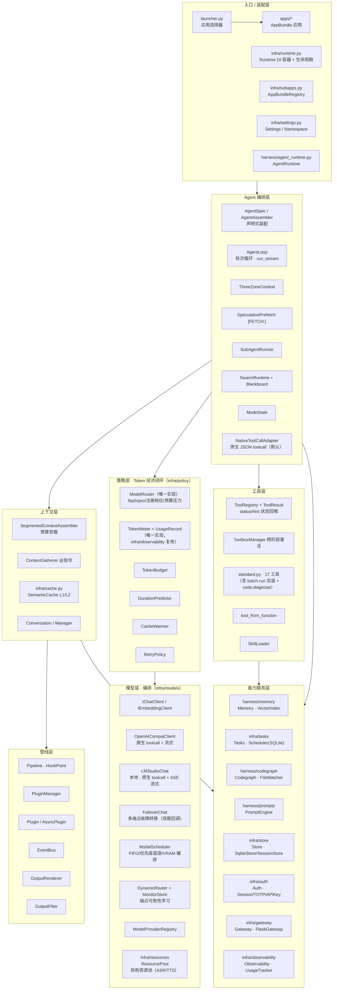
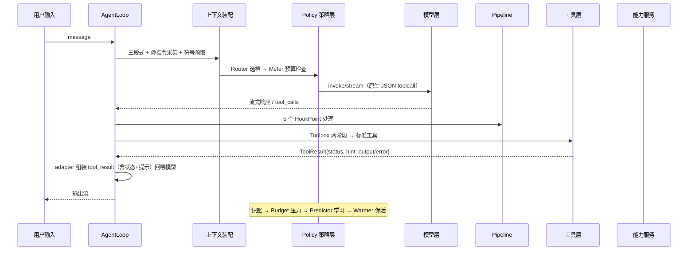

# AICF 系统架构图（当前代码）

> 依据 infra/ 与 harness/ 源码模块结构绘制（2026-08-14，v0.4.0+ 重构后；分层命名按 AICF 更新）。
> `infra/` = 基础设施与运行时管理（orchestrator / resources / runtime / subapps / settings /
> cache / store / observability / tasks / gateway / auth / policy）；
> `harness/` = Agent 核心（agent / tools / pipeline / personality / memory / prompts / skills /
> codegraph / context assembly / SDK）。

## 一、分层架构

## 二、一次请求的数据流（含 toolcall 状态回喂）

## 三、多模型协同 / 本地-API 编排（从 DSN 广义化）

| DSN 原实现 | AICF 广义实现 | 广义化方式 |
|---|---|---|
| apps/dsn/models/scheduler.py | infra/models/scheduler.py | 去 Config 依赖；profiles_dir/超时/load_fn 注入 |
| apps/dsn/models/dynamic_router.py | infra/models/dynamic_router.py | AccountProvider/ManagedAccount 协议；manual_schedule 回调 |
| apps/dsn/models/api_accounts.py FailoverChat | infra/models/failover.py | IChatClient 契约 + on_observation 回调 + 流式故障转移 |
| apps/dsn/models/clients.py LMStudioChat | infra/models/lmstudio.py | 原生 toolcall + SSE 流式；DSN 保留视觉/历史扩展 |

DSN 侧全部改为 AICF 的薄子类（scheduler/dynamic_router/api_accounts/clients），
boot 经 ModelProviderRegistry 注册 openai/lmstudio/embedding 工厂。

## 四、本轮清理与强化

- ✅ 合并重复：ModelRouter 唯一实现在 infra/policy/router.py（含 TierConfig 多档）；
  UsageRecord/fmt_tokens/in_peak_hours 唯一实现在 infra/policy/token_meter.py，
  infra/observability.usage 复用；旧 infra/models/router.py 与 usage 本地副本删除。
- ✅ 原生 JSON toolcall：NativeToolCallAdapter 默认 + OpenAI/LMStudio 客户端
  均走原生 function calling；toolcall 结果回喂含 success/status/output/error/hint。
- ✅ 工具集 17 个：batch.run 实装（按已注册工具批量执行），新增 code.diagnose。
- ✅ 驼峰命名：AICF（infra/ + harness/）与 DSN 自有代码已全部 snake_case（仅 vendored pyncm
  与 stdlib/外部 API 属性名例外，不改动）。
